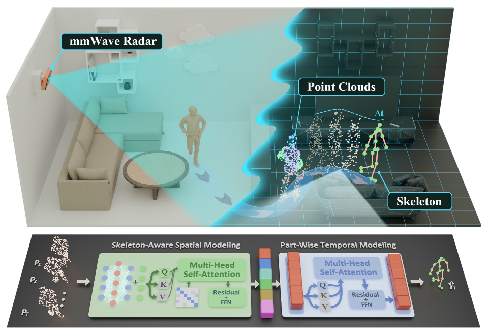
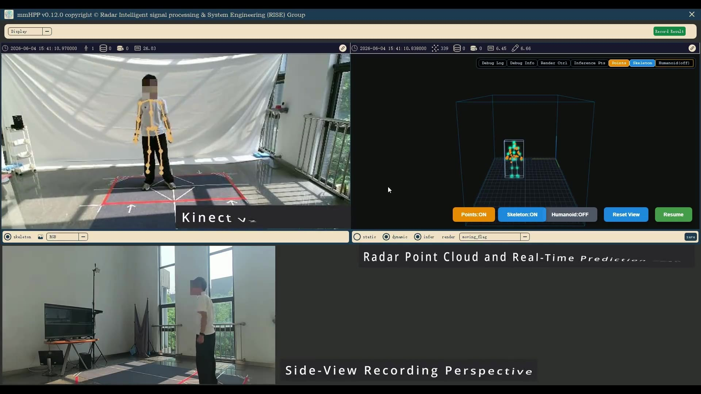

# mmWave-DensePose

Official code, dataset and pretrained models for
[**Human Pose Estimation Using Millimeter-Wave Radar: Prototype, Dataset, and Method**](https://www.sciencedirect.com/science/article/pii/S2095809926005606),
**Engineering, 2026**.

Jiang Liu, Yan Huang, Yanjun Zhang, Chengchang Tian, Zhen Yang, Kaihang Zheng,
Rui Zhou, Hui Zhang, Jixin Chen and Wei Hong.

[](https://doi.org/10.1016/j.eng.2026.10.001)
[](https://seu-rise.github.io/mmWave-DensePose/)
[](https://www.scidb.cn/detail?dataSetId=96bb16b514eb4f69b79293d230666c10)
[](docs/guides/paper-assets.md)
[](docs/guides/README.md)
[](LICENSE)

[Quick Start](#quick-start) · [Dataset](#dataset-and-pretrained-assets) ·
[Train & Test](#train-and-test-from-the-command-line) ·
[CLI Reference](docs/guides/cli-reference.md) · [Citation](#citation)

mmWave-DensePose combines a dense point-cloud radar prototype, a synchronized
multimodal dataset and **PAST-Net**, a Part-Aware Spatio-Temporal Network for
radar-only 3D human pose estimation. PAST-Net achieves **4.08 cm mean localization
error** on the paper benchmark using radar points as its only input.



## Quick start

Use [uv](https://docs.astral.sh/uv/) from the repository root. Python and package
versions are pinned in `.python-version`, `pyproject.toml` and `uv.lock`.

Start the English web workbench to browse Dataset, Training & Testing, Results
and Official results:

```bash
uv sync --locked
uv run --locked python app.py --data-root data/mmwave_densepose --trust-pickle --open-browser
```

Open the complete URL printed by the server, including `#token=...`. Enable
`--trust-pickle` only for trusted dataset and prediction files. Existing official
logs, tables and figures can be viewed before downloading the large assets;
Dataset playback and saved-prediction views use installed data.

For local or SSH access, see the [web workbench guide](docs/guides/web-gui.md).

## Dataset and pretrained assets

| Dataset property | Value |
| --- | --- |
| Subjects / continuous sequences | 101 / 141 |
| Motion coverage | 19 designed motions and free motion |
| Valid synchronized frames | 570,124 |
| Radar attributes | XYZ, Doppler and SNR |
| Pose annotations | 19 Kinect V2 joints |
| Synchronized reference modalities | Anonymized color, depth, infrared, body index and timestamps |

The dataset, model weights and saved prediction packages are published on
[ScienceDB](https://www.scidb.cn/detail?dataSetId=96bb16b514eb4f69b79293d230666c10).
Install the dataset into its managed location:

```bash
uv run --locked python scripts/download_dataset.py
```

The installer verifies package checksums and places files under
`data/mmwave_densepose/`. Training creates numeric caches and split indexes
automatically from the model, split strategy, seed and preprocessing settings.
See [dataset installation](docs/guides/dataset.md) for storage requirements,
package selection, verification and repair.

Large dataset files, checkpoints and prediction PKLs are distributed separately
from Git. Curated official logs, experiment configurations and paper figures and
tables are included in the checkout. Use the
[official asset installer](docs/guides/paper-assets.md) to install weights and
optional prediction PKLs at the registered paths.

## Train and test from the command line

Select a compute profile first:

```bash
uv sync --locked --extra cu118
```

Keep `--extra cu118` on subsequent `uv run` commands. For CPU execution, use
`--extra cpu` and `--device cpu`. See [environment setup](docs/guides/environment.md)
for supported platforms. Multiline commands below use Bash continuations; join
the lines without `\` when pasting into PowerShell.

### Train PAST-Net

This command supplies the model, data protocol and optimization parameters
explicitly, without a configuration file:

```bash
uv run --locked --extra cu118 python scripts/train.py \
  --model PASTNet --data-root data/mmwave_densepose \
  --split-strategy sequence_chunk --seed 42 --partition 0.8 0.1 0.1 \
  --split-chunk-size 200 --max-timestamp-gap-ms 300 --min-valid-points 50 \
  --num-points 300 --input-dim 5 --seq-len 5 --num-joints 19 --ablation full \
  --epochs 200 --batch-size 128 --learning-rate 0.0005 --weight-decay 0.00001 \
  --optimizer adam --scheduler-name cosine --scheduler-eta-min 0.000001 \
  --num-workers 0 --device cuda
```

The terminal prints the allocated run directory and best checkpoint path.
Checkpoints are selected using validation metrics.

### Test an official checkpoint

Download the prepared PAST-Net weight, then evaluate it with explicit parameters:

```bash
uv run --locked --extra cu118 python scripts/download_paper_assets.py --asset main-pastnet
uv run --locked --extra cu118 python scripts/evaluate.py \
  --model PASTNet --checkpoint paper/experiments/main-pastnet/checkpoints/best.ckpt \
  --data-root data/mmwave_densepose --split-strategy sequence_chunk \
  --seed 42 --partition 0.8 0.1 0.1 --split-chunk-size 200 \
  --max-timestamp-gap-ms 300 --min-valid-points 50 \
  --num-points 300 --input-dim 5 --seq-len 5 --num-joints 19 --ablation full \
  --batch-size 128 --num-workers 0 --device cuda --visual
```

For your own trained model, replace `--checkpoint` and use the same input,
preprocessing, split and model-variant parameters as that training run.
`--visual` exports `test_results.pkl` for frame playback in Results.

- [Training and evaluation](docs/guides/training.md): explicit train/test/validate/predict commands, multi-GPU training and PCC dependencies.
- [Complete CLI reference](docs/guides/cli-reference.md): every argument, default, allowed value and task-specific behavior.
- [Official results](docs/guides/official-results.md): paper experiment mapping, table commands and recorded protocol details.

`--config` remains optional. The prepared paper configurations live in
`paper/configs/`; explicit CLI arguments override supplied configuration values.

## Repository layout and outputs

| Path | Contents |
| --- | --- |
| `app.py` | Browser workbench entry point |
| `scripts/` | Dataset/asset downloads and train, evaluate, validate and infer entry points |
| `mmwave_densepose/models/` | Model implementations using CamelCase identifiers |
| `mmwave_densepose/data/` | Dataset processing and automatic caches |
| `mmwave_densepose/engine/` | Training, evaluation and run artifacts |
| `mmwave_densepose/web/` | Browser interface and local/demo service |
| `paper/` | Official configurations, asset manifests, reference tables, figures and table runner |
| `dataset/` | Published dataset package manifest and installation metadata |
| `data/mmwave_densepose/` | Installed dataset and generated caches |
| `example/` | Standalone environment and model-interface examples |
| `docs/guides/` | User documentation |

Your training and evaluation runs save to:

```text
mmwave_densepose/checkpoints/<Model>/<run-id>/best.ckpt
mmwave_densepose/logs/train/<Model>/<run-id>/
mmwave_densepose/logs/test/<Model>/<training-run-id>/<test-id>/
configs/runs/<Model>/<action>-<config-id>.yaml
```

Each run records its resolved configuration. Official weights are installed
under `paper/experiments/<asset-id>/checkpoints/`; official logs carry an
`_official` directory suffix and remain distinct from your runs in the GUI.
The [training guide](docs/guides/training.md#saved-files) details validation logs,
prediction exports and metric units.

## Real-time application example

The recorded application runs on an NVIDIA T400 under strong illumination.
Acquisition, calibration and live sensor applications are outside this release.

[](docs/assets/video/scene.mp4)

## License

The code is released under the [MIT License](LICENSE).
For dataset and pretrained-model usage terms, refer to the
[ScienceDB release](https://www.scidb.cn/detail?dataSetId=96bb16b514eb4f69b79293d230666c10).
Third-party components retain their respective licenses and notices.

## Citation

If you use the dataset, code, pretrained models or results, please cite:

Liu J, Huang Y, Zhang Y, Tian C, Yang Z, Zheng K, Zhou R, Zhang H, Chen J, Hong W.
**Human Pose Estimation Using Millimeter-Wave Radar: Prototype, Dataset, and Method.**
*Engineering*. 2026. [doi:10.1016/j.eng.2026.10.001](https://doi.org/10.1016/j.eng.2026.10.001).

```bibtex
@article{liu2026mmwavedensepose,
  author  = {Liu, Jiang and Huang, Yan and Zhang, Yanjun and Tian, Chengchang and
             Yang, Zhen and Zheng, Kaihang and Zhou, Rui and Zhang, Hui and
             Chen, Jixin and Hong, Wei},
  title   = {{Human Pose Estimation Using Millimeter-Wave Radar: Prototype, Dataset, and Method}},
  journal = {Engineering},
  year    = {2026},
  doi     = {10.1016/j.eng.2026.10.001},
  url     = {https://www.sciencedirect.com/science/article/pii/S2095809926005606}
}
```
